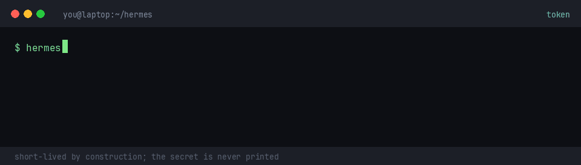

# hermes-setup

<h3 align="center">Least privilege and short tokens for a Hermes agent, generated instead of described.</h3>

<p align="center">
  <a href="LICENSE"></a>
  
  
  
</p>

> A token contract, a default-deny database role and a three-assertion link check — in one command each.

Works in **pi · Claude Code · Codex · Cursor** and any agent that reads a `SKILL.md` — plain
Markdown plus one stdlib script, no agent-specific tools.

<p align="center">
  
</p>

## What it is

`hermes-setup` generates the secret (0600, fingerprint only), mints and verifies short-lived JWTs with `aud=hermes-agent` and an explicit scope, emits least-privilege SQL for exactly the tables the agent reads and writes, and proves the link with three assertions: valid token 200, garbage 401, expired 401.

## Why it exists

Agent integrations fail in two ways: a token that lives too long or is accepted for the wrong audience, and a database user with more rights than the job. Both are configuration, so both can be generated, checked and tested.

## Install

```bash
# any agent, via the skills CLI — this one, or all twelve at once
npx skills add Appit-labs/hermes-setup -g -y
npx skills add Appit-labs/appit-skills -g -y

# Claude Code — the whole collection as one marketplace
claude plugin marketplace add Appit-labs/appit-skills
claude plugin install hermes-setup@appit-skills

# pi
pi install git:github.com/Appit-labs/hermes-setup

# any agent that reads a skills directory
git clone git@github.com:Appit-labs/hermes-setup.git
cp -r hermes-setup/skills/hermes-setup ~/.claude/skills/      # or ~/.codex/skills/, .cursor/skills/, …
```

> **npm name.** `hermes-setup` on npm belongs to another author. This skill is published as
> `@appitlabs/hermes-setup`, and the whole collection as `@appitlabs/skills`.

## Requires

- Python 3.9+ (stdlib only — no JWT or RSA dependency)
- `psql` only if you apply the generated SQL yourself
- The app needs a health endpoint that requires the agent token

## Cost

| | tokens |
| --- | --- |
| always-on — the description, paid every session | ~100 |
| on invoke | ~1.7k |

The demo is a real run: `demos/hermes-setup.json` holds the captured output and `tools/make_demo.py` renders it.

## Provenance

Every command in this skill was run against a real target before it was written down: a live
database, a staging host, a failing CI run, a browser session. The repository was created and
published on 2026-11-18; where the workflow itself is older, `CHANGELOG.md` carries the dates.

## Security

SkillSpector: **0/100, SAFE, 0 open findings** against the committed baseline; every accepted
finding is listed with its reason in [SECURITY.md](SECURITY.md).

## Part of the Appit collection

All twelve, one install: `npx skills add Appit-labs/appit-skills -g -y`.

- [`live-qa`](https://github.com/Appit-labs/live-qa) — live QA in a real browser
- [`ci-triage`](https://github.com/Appit-labs/ci-triage) — red CI to the failing line
- [`pg-inspect`](https://github.com/Appit-labs/pg-inspect) — read-only Postgres inspection
- [`repo-runbook`](https://github.com/Appit-labs/repo-runbook) — the verified runbook in AGENTS.md
- [`remote-exec`](https://github.com/Appit-labs/remote-exec) — SSH that cannot hang
- [`trello-tickets`](https://github.com/Appit-labs/trello-tickets) — seven ticket types, one card
- [`cloud-browser`](https://github.com/Appit-labs/cloud-browser) — hosted browsers that stop billing
- [`open-design`](https://github.com/Appit-labs/open-design) — the OpenDesign monorepo
- [`blender-pipeline`](https://github.com/Appit-labs/blender-pipeline) — Blender via MCP
- [`code-scan`](https://github.com/Appit-labs/code-scan) — Skylos + Fallow, one gate
- [`release`](https://github.com/Appit-labs/release) — conventional commits to a tag
- [`hermes-setup`](https://github.com/Appit-labs/hermes-setup) — least-privilege agent wiring ← this skill


## License

MIT, copyright Appit Labs. See [LICENSE](LICENSE).
